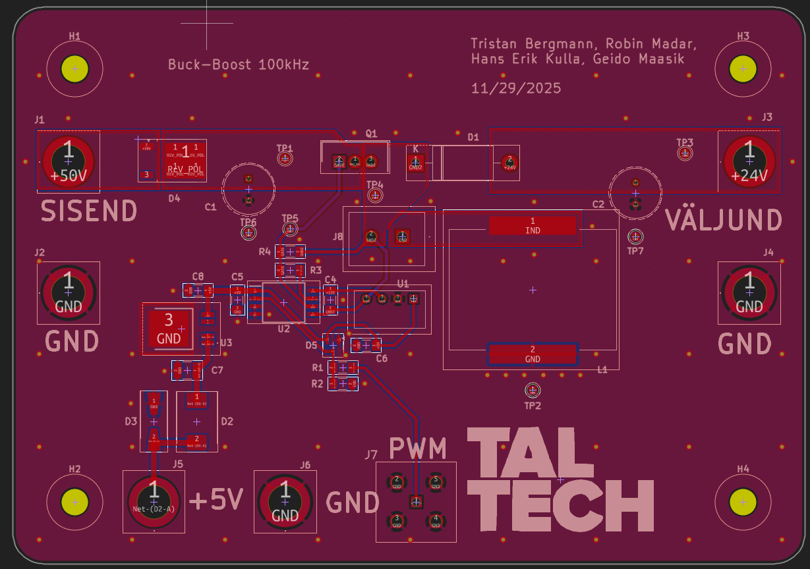

# 100kHz alalisvoolu alandavmuundur

Seoses TalTech projekti raames. Esines probleeme, aga v0 töötas.

* ROE1205S pinout on tagurpidi.
* Üks elektrolüüt on ühtpidi, teine teistpidi.

Saab väiksemalt, vähemalt pugav joota.
Parts list pole vist ka väga kallis.